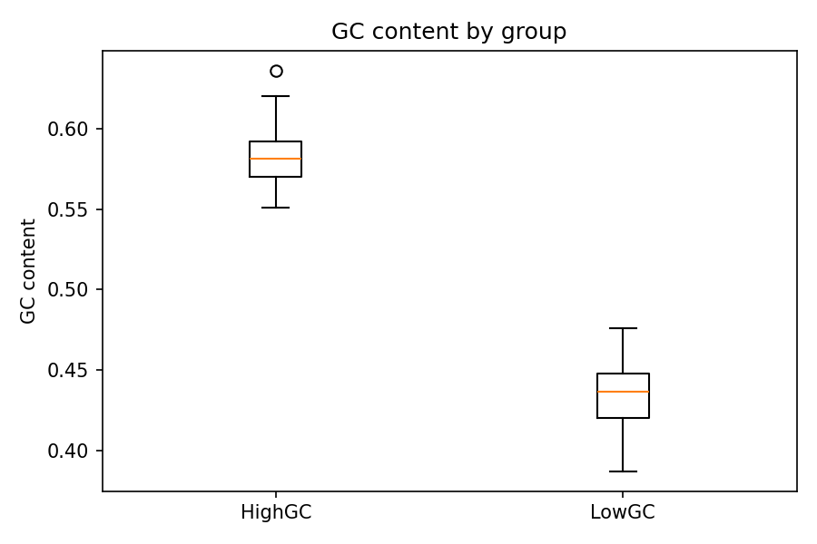
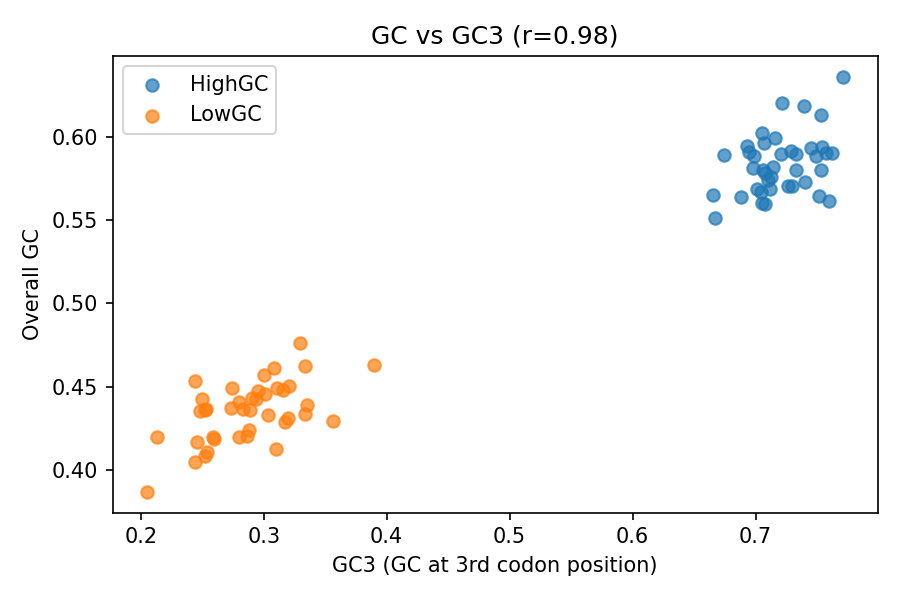
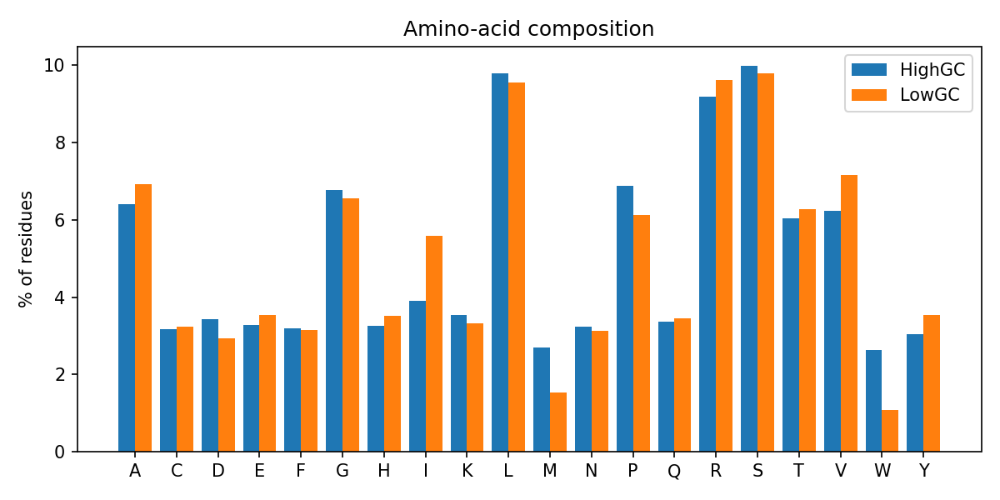
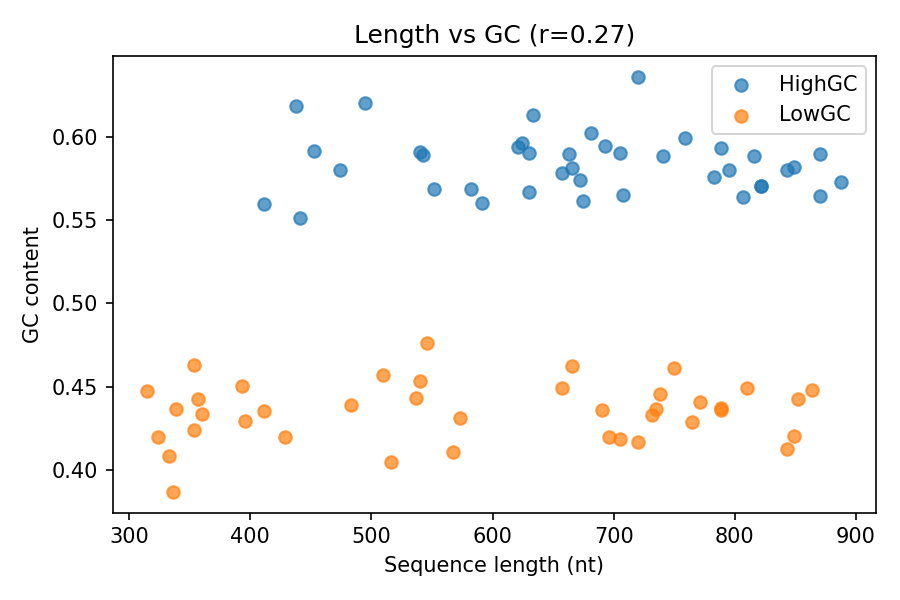

# Final Bioinformatics Report: GC Content and Codon Composition in Coding Sequences

**Author:** Pravith Kanna · B.Tech Bioinformatics · SWYNEX Bioinformatics Internship, Task 4

> **Data note:** This version was run on a *simulated* dataset (80 coding sequences, 40 per group, random seed 7) so the pipeline is reproducible without downloads. To use real data, place `sequences.fasta` (headers like `>geneID|GroupName`) next to `analysis.py` and rerun; then update the numbers below from `results.json`.

## 1. Question
Do coding sequences from a high-GC group and a low-GC group differ in overall GC content, and is that difference driven by GC at the third codon position (GC3)?

## 2. Methods
- **Data:** FASTA coding sequences (CDS), each with a group label. Real sequences can be downloaded from NCBI Nucleotide/RefSeq; protein annotation can be cross-checked in UniProt.
- **Tools:** Python (pandas, NumPy, matplotlib); no external bioinformatics libraries.
- **Per-sequence metrics:** length (nt), overall GC fraction, GC3 (fraction of codons ending in G/C), and translation with the standard genetic code (NCBI table 1).
- **Statistics:** difference in mean GC between groups, tested with a two-sided permutation test (10,000 shuffles); Pearson correlation for GC vs GC3 and length vs GC.
- **Code:** `analysis.py`; outputs `sequence_stats.csv`, `results.json`, `fig1`–`fig4`.

## 3. Results
| Metric | HighGC | LowGC |
|---|---|---|
| Sequences | 40 | 40 |
| Mean GC (± SD) | 0.584 ± 0.018 | 0.435 ± 0.018 |
| Mean GC3 | 0.720 | 0.287 |
| Mean length (nt) | 673.8 | 584.8 |

- GC content differs by **0.149** between groups (permutation p < 0.001) (Fig. 1).
- GC and GC3 are almost perfectly correlated (**r = 0.98**) (Fig. 2).
- Amino-acid composition shifts between groups, consistent with codon-bias effects (Fig. 3).
- Length and GC are only weakly correlated (**r = 0.27**) (Fig. 4).

## 4. Interpretation
The groups clearly differ in GC content, and GC3 tracks overall GC very closely, so third-position (synonymous) choices account for most of the difference.

**What this does not show:** *why* the bias exists (mutation pressure, selection, or gene conversion cannot be separated here); it says nothing about function or expression; and correlation of GC with GC3 is partly built in, because GC3 is a component of GC.

## 5. Limitations
- The included results come from simulated sequences, where the difference was built into the generator; they demonstrate the pipeline, not biology. Real data may behave differently.
- Small sample (40 per group) and no control for phylogenetic relatedness or gene function.
- Only mean-level tests; no codon-usage indices (e.g. RSCU, ENC) or multiple-testing considerations.
- Sequences were not checked for annotation errors or frame problems.

## 6. References
1. Altschul SF, et al. (1990). Basic local alignment search tool. *J Mol Biol* 215:403–410.
2. Cock PJA, et al. (2009). Biopython: freely available Python tools for computational molecular biology and bioinformatics. *Bioinformatics* 25:1422–1423.
3. Hunter JD (2007). Matplotlib: a 2D graphics environment. *Computing in Science & Engineering* 9:90–95.
4. NCBI Resource Coordinators. Database resources of the National Center for Biotechnology Information. *Nucleic Acids Res* (annual issue).
5. The UniProt Consortium. UniProt: the Universal Protein Knowledgebase. *Nucleic Acids Res* (annual issue).
6. NCBI Genetic Codes, Table 1 (standard code): https://www.ncbi.nlm.nih.gov/Taxonomy/Utils/wprintgc.cgi
